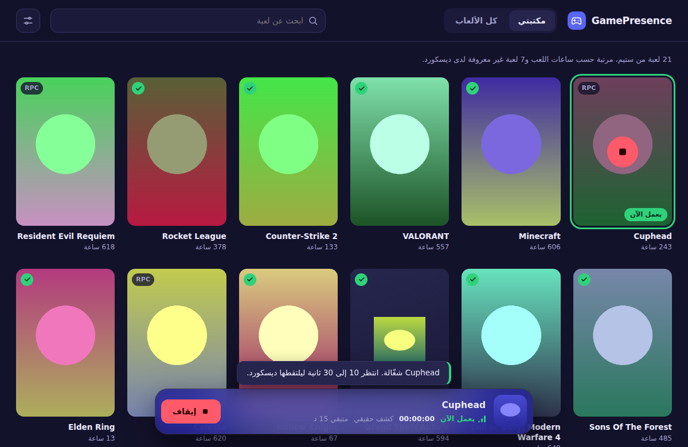

# GamePresence

[](https://github.com/nciiz/game-presence/actions/workflows/ci.yml)  [](https://github.com/nciiz/game-presence/blob/main/LICENSE)

**اختر لعبة، وتظهر كنشاطك في ديسكورد.** يعمل على ويندوز ولينكس.

[English](README.md)



*المعاينة تستخدم صوراً تجريبية. داخل التطبيق تظهر ألعاب ستيم بأغلفتها الحقيقية.*

## المميزات

- تصفّح **مكتبة ستيم** (بأغلفة حقيقية) أو **كل الألعاب التي يعرفها ديسكورد**.
- ضغطة وحدة تشغّل اللعبة كنشاط حقيقي في ديسكورد، وضغطة ثانية توقفها.
- طريقتان للتشغيل، ويختار التطبيق المناسبة تلقائياً:
  - **كشف حقيقي**: يشغّل عملية وهمية خفيفة باسم ملف تشغيل اللعبة. هذا هو أسلوب ديسكورد نفسه في اكتشاف الألعاب، فتدخل اللعبة أيضاً في قائمة نشاطك الأخير.
  - **Rich Presence**: بديل للألعاب التي ليس لها ملف تشغيل معروف. يعرض "يلعب X" أثناء التشغيل مع نص اختياري للتفاصيل والحالة.
- عدّاد للجلسة وإيقاف تلقائي اختياري (من 5 دقائق إلى 3 ساعات).
- واجهة عربية (من اليمين لليسار) وإنجليزية، تصميم داكن، بحث فوري، وسرعة حتى مع آلاف الألعاب.

## كيف يعمل

ينشر ديسكورد قائمة بالألعاب القابلة للاكتشاف (`/api/v9/applications/detectable`) مع أسماء ملفات تشغيل كل لعبة. تطبيق ديسكورد على جهازك يقارن العمليات الشغالة بهذه القائمة. يشغّل GamePresence عملية وهمية صغيرة (`ping` على ويندوز و`sleep` على لينكس) بنفس اسم ملف اللعبة ومساره، فيعتبرها ديسكورد لعبة شغالة. عند الإيقاف تُغلق العملية.

وللألعاب التي ليس لها ملف تشغيل معروف، يستخدم التطبيق Rich Presence عبر قناة IPC المحلية.

## التثبيت

### ويندوز

نزّل `GamePresence-windows-x64.zip` من صفحة [Releases](https://github.com/nciiz/game-presence/releases)، فك الضغط وشغّل `GamePresence.exe`.

أو ابنِه بنفسك (يحتاج [Python 3.10–3.12](https://www.python.org/downloads/) مع تفعيل **Add Python to PATH**):

```bat
git clone https://github.com/nciiz/game-presence.git
cd game-presence
scripts\build_windows.bat
```

ينتج `dist\GamePresence\GamePresence.exe` واختصار على سطح المكتب.

يحتاج مكوّن Microsoft Edge **WebView2** (موجود في ويندوز 11 وأغلب نسخ ويندوز 10 المحدّثة).

### لينكس (تجريبي)

```bash
git clone https://github.com/nciiz/game-presence.git
cd game-presence
bash scripts/install_linux.sh
```

يثبّت السكربت GTK/WebKit (أو Qt كبديل) في بيئة بايثون خاصة، ويضيف **GamePresence** لقائمة التطبيقات. للحذف: `bash scripts/install_linux.sh --uninstall`.

### من الكود (أي نظام)

```bash
python -m pip install -r requirements.txt
python -m gamepresence
```

على لينكس تحتاج أيضاً GTK وWebKit2 (`python3-gi gir1.2-webkit2-4.1` في Debian/Ubuntu) أو `pip install "pywebview[qt]"`.

## الاستخدام

1. افتح التطبيق واختر لعبة من **كل الألعاب**، أو اربط ستيم أولاً.
2. **ستيم (اختياري):** افتح الإعدادات، والصق [مفتاح Steam Web API](https://steamcommunity.com/dev/apikey) مع SteamID64 (أو اسم الملف المخصص)، ثم اضغط *حفظ وتحديث المكتبة*. لازم يكون ملفك وخيار **Game details** على **Public** في خصوصية ستيم.
3. اضغط على لعبة لتشغيلها. اضغط عليها مرة ثانية، أو زر **إيقاف** في الشريط السفلي، لإيقافها.

أبقِ تطبيق ديسكورد **الديسكتوب** مفتوحاً، وأعطه 10 إلى 30 ثانية ليلتقط النشاط الجديد. الإعدادات تُحفظ في `~/.gamepresence.json` (ومفتاح ستيم محفوظ هناك كنص عادي، فلا ترفعه أبداً).

## أسئلة شائعة

**ليش ما تظهر تاقات مثل "New Player" أو "Trending"؟**
هذي التاقات يحسبها ديسكورد من بياناته (سجلك مع اللعبة وشعبيتها)، ولا يقدر GamePresence أن يضعها أو يفرضها.

**لعبة عليها علامة `RPC` بدل علامة الصح.**
ديسكورد ما عنده ملف تشغيل معروف لها على نظامك، فالمتاح Rich Presence فقط. يعرض اللعبة أثناء التشغيل لكنه لا يضيفها لقائمة النشاط الأخير.

**الكشف الحقيقي ما يشتغل على لينكس.**
ديسكورد المثبّت بصيغة **Flatpak أو Snap** معزول ولا يرى العمليات خارج صندوقه. استخدم Rich Presence، أو ثبّت ديسكورد من ملف `.deb` أو `.tar.gz` الرسمي. دعم أسماء `.exe` لألعاب Wine/Proton على لينكس بأقصى جهد دون ضمان.

**النافذة فاضية على لينكس.**
شغّل بالأمر `WEBKIT_DISABLE_DMABUF_RENDERER=1 gamepresence` (المثبّت يضيفه أصلاً). أو ثبّت Qt: `pip install "pywebview[qt]"`.

**وين السجلات؟**
ويندوز: `C:\Users\<اسمك>\GamePresence\log.txt`. لينكس: `~/.local/share/gamepresence/log.txt`.

## هيكل المشروع

```
gamepresence/
  app.py       النافذة وجسر JS ونقطة التشغيل
  core.py      الإعدادات وقائمة ألعاب ديسكورد ومطابقة ستيم
  worker.py    خيط العملية الوهمية / Rich Presence
  models.py    نموذج اللعبة ودوال الأسماء
  bus.py       قناة الأحداث من بايثون إلى الواجهة
  config.py    المسارات وأعلام النظام ودوال مساعدة
  ui/index.html  الواجهة كاملة (HTML/CSS/JS بدون خطوة بناء)
scripts/       build_windows.bat و install_linux.sh
tests/         اختبارات (لا تحتاج واجهة ولا ديسكورد)
assets/        الأيقونات
```

## التطوير

```bash
python -m pip install requests
python -m unittest discover -t . -s tests -v
```

الواجهة تتواصل مع بايثون عبر `window.pywebview.api` (انظر `Api` في `app.py`) وتستقبل الأحداث عبر `window.onEvent` (انظر `Bus`). يوجد اختبار يتأكد أن كل استدعاء تستخدمه الواجهة موجود فعلاً.

عند رفع وسم مثل `v3.1.0` يعمل `.github/workflows/release.yml` ويبني ملف ويندوز المضغوط وحزمة لينكس ويرفقهما بإصدار GitHub.

## تنبيه

GamePresence مشروع مستقل، **وغير تابع لشركة Discord ولا Valve ولا مدعوم منهما**. محاكاة عمليات الألعاب لتغيير ما يعرضه ديسكورد قد تخالف شروط خدمة ديسكورد أو إرشادات مجتمعهم، وقد تعرّض حسابك للخطر. لا تستخدمه للحصول على مكافآت Quests أو لخداع أنظمة ديسكورد بأي طريقة. الاستخدام على مسؤوليتك.

## الرخصة

[MIT](LICENSE)
