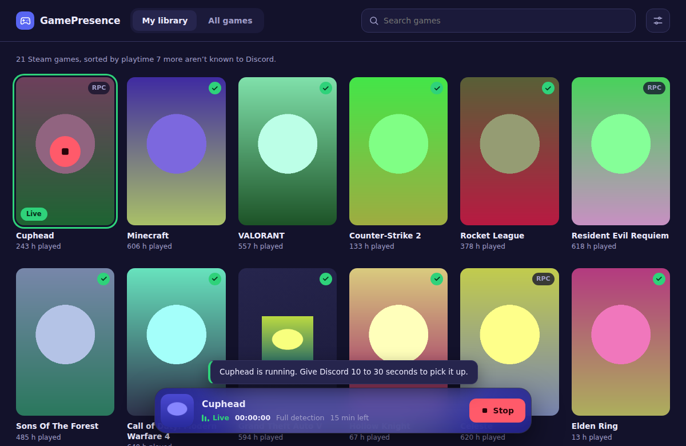

# GamePresence

[](https://github.com/nciiz/game-presence/actions/workflows/ci.yml)  [](https://github.com/nciiz/game-presence/blob/main/LICENSE)

**Pick a game, and show it as your Discord activity.** Runs on Windows and Linux.

[العربية](README.ar.md)



*The preview uses placeholder artwork. In the app, Steam games show their real covers.*

## Features

- Browse your **Steam library** (real cover art) or **every game Discord knows about**.
- One click starts the game as a real Discord activity; one click stops it.
- Two methods, chosen automatically:
  - **Full detection** — starts a harmless placeholder process named like the game's executable. This is how Discord itself detects games, so the game also appears in your recent-activity list.
  - **Rich Presence** — fallback for games with no known executable. Shows "Playing X" while it runs, with optional details and state text.
- Session timer, optional auto-stop (5 minutes to 3 hours).
- Arabic (RTL) and English interface, dark theme, instant search, fast even with thousands of games.

## How it works

Discord publishes a list of detectable games (`/api/v9/applications/detectable`) with each game's executable names. Discord's desktop app compares the processes running on your computer with that list. GamePresence starts a tiny placeholder process (`ping` on Windows, `sleep` on Linux) with the game's executable name and path, so Discord reports the game as running. When you stop, the process is killed.

For games with no known executable, GamePresence falls back to Discord Rich Presence over the local IPC socket.

## Install

### Windows

Download `GamePresence-windows-x64.zip` from the [Releases](https://github.com/nciiz/game-presence/releases) page, unzip it and run `GamePresence.exe`.

Or build it yourself (needs [Python 3.10–3.12](https://www.python.org/downloads/), tick **Add Python to PATH**):

```bat
git clone https://github.com/nciiz/game-presence.git
cd game-presence
scripts\build_windows.bat
```

This creates `dist\GamePresence\GamePresence.exe` and a Desktop shortcut.

Requires the Microsoft Edge **WebView2** runtime (already included in Windows 11 and up-to-date Windows 10).

### Linux (experimental)

```bash
git clone https://github.com/nciiz/game-presence.git
cd game-presence
bash scripts/install_linux.sh
```

The installer sets up GTK/WebKit (or the Qt backend as a fallback) in a private Python environment and adds **GamePresence** to your app menu. Remove it with `bash scripts/install_linux.sh --uninstall`.

### From source (any OS)

```bash
python -m pip install -r requirements.txt
python -m gamepresence
```

On Linux you also need GTK + WebKit2 (`python3-gi gir1.2-webkit2-4.1` on Debian/Ubuntu) or `pip install "pywebview[qt]"`.

## Usage

1. Open the app and pick a game from **All games**, or connect Steam first.
2. **Steam (optional):** open Settings, paste a [Steam Web API key](https://steamcommunity.com/dev/apikey) and your SteamID64 (or custom profile name), then press *Save and refresh library*. Your profile and **Game details** must be set to **Public** in Steam's privacy settings.
3. Click a game to start it. Click it again, or press **Stop** in the bottom bar, to stop.

Keep Discord's **desktop app** open. Give Discord 10–30 seconds to notice a new activity. Settings are saved in `~/.gamepresence.json` (your Steam key is stored there in plain text; never commit it).

## FAQ

**Why don't I get tags like "New Player" or "Trending"?**
Those labels are computed by Discord from its own data (your history with the game, how popular the game is). GamePresence can't set or force them.

**A game shows `RPC` instead of a check mark.**
Discord has no known executable for it on your OS, so only Rich Presence is possible. Rich Presence shows the game while it runs, but it does not add the game to your recent-activity list.

**Full detection doesn't work on Linux.**
Discord installed as a **Flatpak or Snap** is sandboxed and cannot see processes outside its sandbox. Use Rich Presence, or install Discord from the official `.deb`/`.tar.gz`. Support for Wine/Proton `.exe` names on Linux is best-effort.

**The window is blank on Linux.**
Launch with `WEBKIT_DISABLE_DMABUF_RENDERER=1 gamepresence` (the installer already sets this). Or install the Qt backend: `pip install "pywebview[qt]"`.

**Where are the logs?**
Windows: `C:\Users\<you>\GamePresence\log.txt`. Linux: `~/.local/share/gamepresence/log.txt`.

## Project layout

```
gamepresence/
  app.py       window, JS bridge, entry point
  core.py      settings, Discord game catalog, Steam matching
  worker.py    placeholder process / Rich Presence worker thread
  models.py    Game model and name helpers
  bus.py       Python -> UI event channel
  config.py    paths, platform flags, small helpers
  ui/index.html  the whole interface (HTML/CSS/JS, no build step)
scripts/       build_windows.bat, install_linux.sh
tests/         unit tests (no GUI or Discord needed)
assets/        app icons
```

## Development

```bash
python -m pip install requests
python -m unittest discover -t . -s tests -v
```

The interface talks to Python through `window.pywebview.api` (see `Api` in `app.py`) and receives events through `window.onEvent` (see `Bus`). A test checks that every API call used by the UI exists.

Pushing a tag such as `v3.1.0` runs `.github/workflows/release.yml`, which builds the Windows zip and a Linux bundle and attaches them to a GitHub Release.

## Disclaimer

GamePresence is an independent project. It is **not affiliated with or endorsed by Discord Inc. or Valve**. Imitating game processes to change what Discord displays may go against Discord's Terms of Service or Community Guidelines and could put your account at risk. Do not use it to claim Quest rewards or to deceive Discord's systems in any other way. Use it at your own risk.

## License

[MIT](LICENSE)
